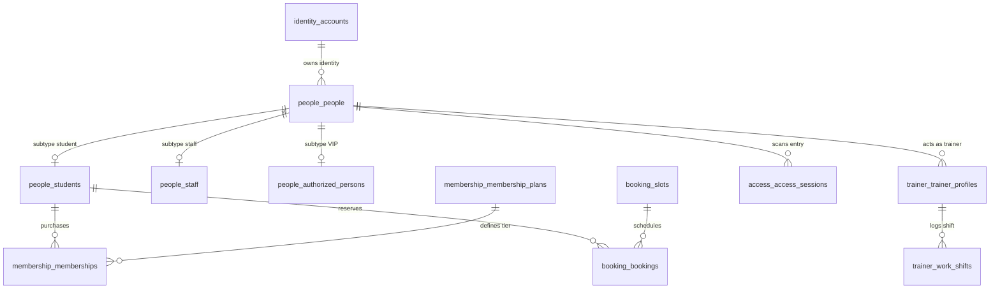

# College Gym Management System — PostgreSQL Multi-Schema Documentation

## 1. Architectural Schema Partitioning (ADR-001)

The system isolates domain data into **11 logical PostgreSQL schemas** within a single database instance (`college_gym`). This separation guarantees high modularity, distinct ownership boundaries, and strict security isolation.

---

## 2. Comprehensive Schema & Table Reference

### 2.1 Schema: `identity`
Manages core login credentials, OAuth identity linking, and session persistence.

#### Table: `identity.accounts`
| Column | Type | Constraints | Description |
| :--- | :--- | :--- | :--- |
| `id` | `UUID` | `PRIMARY KEY`, `DEFAULT gen_random_uuid()` | Internal unique account ID |
| `email` | `VARCHAR(255)` | `NOT NULL`, `UNIQUE` | Institutional email address |
| `role` | `VARCHAR(50)` | `NOT NULL`, `DEFAULT 'student'` | Global system role |
| `is_active` | `BOOLEAN` | `NOT NULL`, `DEFAULT true` | Account active state |
| `last_login_at` | `TIMESTAMPTZ` | `NULLABLE` | Timestamp of last session |
| `created_at` | `TIMESTAMPTZ` | `NOT NULL`, `DEFAULT NOW()` | Record creation timestamp |
| `updated_at` | `TIMESTAMPTZ` | `NOT NULL`, `DEFAULT NOW()` | Record update timestamp |

#### Table: `identity.oauth_providers`
| Column | Type | Constraints | Description |
| :--- | :--- | :--- | :--- |
| `id` | `UUID` | `PRIMARY KEY`, `DEFAULT gen_random_uuid()` | Unique provider record ID |
| `account_id` | `UUID` | `NOT NULL`, `REFERENCES identity.accounts(id) ON DELETE CASCADE` | Associated account |
| `provider` | `VARCHAR(50)` | `NOT NULL`, `DEFAULT 'google'` | Identity provider name |
| `provider_user_id`| `VARCHAR(255)` | `NOT NULL` | External Google subject sub ID |
| `profile_data` | `JSONB` | `NULLABLE` | Cached Google profile claims |
| `created_at` | `TIMESTAMPTZ` | `NOT NULL`, `DEFAULT NOW()` | Record creation timestamp |

#### Table: `identity.sessions`
| Column | Type | Constraints | Description |
| :--- | :--- | :--- | :--- |
| `id` | `VARCHAR(128)` | `PRIMARY KEY` | High-entropy session UUID token |
| `account_id` | `UUID` | `NOT NULL`, `REFERENCES identity.accounts(id) ON DELETE CASCADE` | Associated account |
| `user_agent` | `VARCHAR(512)` | `NULLABLE` | Client browser user agent |
| `ip_address` | `VARCHAR(45)` | `NULLABLE` | Client IP address |
| `expires_at` | `TIMESTAMPTZ` | `NOT NULL` | Absolute session expiration |
| `created_at` | `TIMESTAMPTZ` | `NOT NULL`, `DEFAULT NOW()` | Session issuance timestamp |

---

### 2.2 Schema: `people`
Directory records, student roll numbers, staff IDs, biometric statuses, and residency classifications.

#### Table: `people.people`
| Column | Type | Constraints | Description |
| :--- | :--- | :--- | :--- |
| `id` | `UUID` | `PRIMARY KEY`, `DEFAULT gen_random_uuid()` | Physical person record ID |
| `account_id` | `UUID` | `NULLABLE`, `REFERENCES identity.accounts(id) ON DELETE SET NULL` | Linked auth account |
| `name` | `VARCHAR(255)` | `NOT NULL` | Full legal name |
| `email` | `VARCHAR(255)` | `NOT NULL`, `UNIQUE` | Primary email address |
| `phone` | `VARCHAR(20)` | `NULLABLE` | Contact mobile number |
| `person_type` | `VARCHAR(50)` | `NOT NULL` | `student` \| `staff` \| `trainer` \| `admin` \| `authorized_person` |
| `status` | `VARCHAR(50)` | `NOT NULL`, `DEFAULT 'active'` | `active` \| `suspended` \| `departed` |
| `created_at` | `TIMESTAMPTZ` | `NOT NULL`, `DEFAULT NOW()` | Record creation timestamp |
| `updated_at` | `TIMESTAMPTZ` | `NOT NULL`, `DEFAULT NOW()` | Record update timestamp |

#### Table: `people.students`
| Column | Type | Constraints | Description |
| :--- | :--- | :--- | :--- |
| `id` | `UUID` | `PRIMARY KEY`, `DEFAULT gen_random_uuid()` | Student record ID |
| `person_id` | `UUID` | `NOT NULL`, `UNIQUE`, `REFERENCES people.people(id) ON DELETE CASCADE` | Associated person |
| `roll_number` | `VARCHAR(50)` | `NOT NULL`, `UNIQUE` | Institutional roll number (e.g. `2024CS001`) |
| `department` | `VARCHAR(100)` | `NOT NULL` | Department abbreviation (e.g. `CSE`, `ECE`) |
| `joining_year`| `INTEGER` | `NOT NULL` | Year of enrollment (e.g. `2024`) |
| `residency` | `VARCHAR(50)` | `NOT NULL`, `DEFAULT 'day_scholar'` | `hosteller` \| `day_scholar` |
| `face_enrollment_status` | `VARCHAR(50)` | `NOT NULL`, `DEFAULT 'not_enrolled'` | `not_enrolled` \| `pending` \| `synced` \| `purged` |
| `face_reference_id` | `VARCHAR(255)` | `NULLABLE` | ZKBio facial vector template ID |
| `is_banned` | `BOOLEAN` | `NOT NULL`, `DEFAULT false` | Active disciplinary ban flag |
| `ban_expires_at` | `TIMESTAMPTZ` | `NULLABLE` | Timestamp when suspension expires |
| `violation_count` | `INTEGER` | `NOT NULL`, `DEFAULT 0` | Active strike count (0 to 3) |

#### Table: `people.staff`
| Column | Type | Constraints | Description |
| :--- | :--- | :--- | :--- |
| `id` | `UUID` | `PRIMARY KEY`, `DEFAULT gen_random_uuid()` | Staff record ID |
| `person_id` | `UUID` | `NOT NULL`, `UNIQUE`, `REFERENCES people.people(id) ON DELETE CASCADE` | Associated person |
| `staff_id` | `VARCHAR(50)` | `NOT NULL`, `UNIQUE` | Institutional employee ID |
| `department` | `VARCHAR(100)` | `NOT NULL` | Academic/Administrative department |
| `designation` | `VARCHAR(100)` | `NULLABLE` | Official faculty/staff designation |

#### Table: `people.authorized_persons`
| Column | Type | Constraints | Description |
| :--- | :--- | :--- | :--- |
| `id` | `UUID` | `PRIMARY KEY`, `DEFAULT gen_random_uuid()` | VIP authorization ID |
| `person_id` | `UUID` | `NOT NULL`, `UNIQUE`, `REFERENCES people.people(id) ON DELETE CASCADE` | Associated person |
| `designation` | `VARCHAR(100)` | `NOT NULL` | Role (e.g. `Visiting Dignitary`, `Sports Officer`) |
| `notes` | `TEXT` | `NULLABLE` | Clearance rationale |
| `revoked_at` | `TIMESTAMPTZ` | `NULLABLE` | Revocation timestamp |

---

### 2.3 Schema: `booking`
Time slots, rolling window reservations, and disciplinary strike logs.

#### Table: `booking.slots`
| Column | Type | Constraints | Description |
| :--- | :--- | :--- | :--- |
| `id` | `UUID` | `PRIMARY KEY`, `DEFAULT gen_random_uuid()` | Slot unique ID |
| `slot_date` | `DATE` | `NOT NULL` | IST calendar date (`YYYY-MM-DD`) |
| `start_time` | `TIME` | `NOT NULL` | Slot start time (e.g. `06:00:00`) |
| `end_time` | `TIME` | `NOT NULL` | Slot end time (e.g. `07:00:00`) |
| `capacity` | `INTEGER` | `NOT NULL`, `DEFAULT 100` | Hard cap limit (100) |
| `booked_count`| `INTEGER` | `NOT NULL`, `DEFAULT 0` | Current booked count |
| `status` | `VARCHAR(50)` | `NOT NULL`, `DEFAULT 'open'` | `open` \| `full` \| `closed` \| `blackout` |
| *Constraint* | `UNIQUE` | `UNIQUE(slot_date, start_time)` | Prevents duplicate time slots per day |

#### Table: `booking.bookings`
| Column | Type | Constraints | Description |
| :--- | :--- | :--- | :--- |
| `id` | `UUID` | `PRIMARY KEY`, `DEFAULT gen_random_uuid()` | Reservation ID |
| `student_id` | `UUID` | `NOT NULL`, `REFERENCES people.students(id) ON DELETE CASCADE` | Reserving student |
| `slot_id` | `UUID` | `NOT NULL`, `REFERENCES booking.slots(id) ON DELETE CASCADE` | Booked time slot |
| `booking_status` | `VARCHAR(50)` | `NOT NULL`, `DEFAULT 'booked'` | `booked` \| `attended` \| `no_show` \| `cancelled_by_user` \| `cancelled_by_gym` |
| `access_status` | `VARCHAR(50)` | `NOT NULL`, `DEFAULT 'not_entered'` | `not_entered` \| `entered` \| `completed` |
| `cancelled_at` | `TIMESTAMPTZ` | `NULLABLE` | Cancellation timestamp |
| `cancellation_reason`| `VARCHAR(255)`| `NULLABLE` | Cancellation reason |

#### Table: `booking.violations`
| Column | Type | Constraints | Description |
| :--- | :--- | :--- | :--- |
| `id` | `UUID` | `PRIMARY KEY`, `DEFAULT gen_random_uuid()` | Violation strike ID |
| `student_id` | `UUID` | `NOT NULL`, `REFERENCES people.students(id) ON DELETE CASCADE` | Offending student |
| `booking_id` | `UUID` | `NULLABLE`, `REFERENCES booking.bookings(id) ON DELETE SET NULL` | Linked reservation |
| `violation_type` | `VARCHAR(50)` | `NOT NULL` | `no_show` \| `late_cancellation` \| `anti_pass_back` \| `overstay` |
| `description`| `VARCHAR(255)`| `NULLABLE` | Context details |

---

### 2.4 Schema: `membership` & `payment`
Day Scholar membership tiers, pass validity windows, and Razorpay orders.

#### Table: `membership.membership_plans`
| Column | Type | Constraints | Description |
| :--- | :--- | :--- | :--- |
| `id` | `UUID` | `PRIMARY KEY`, `DEFAULT gen_random_uuid()` | Plan ID |
| `name` | `VARCHAR(100)`| `NOT NULL` | E.g. `1-Month Student Pass` |
| `duration_days`| `INTEGER` | `NOT NULL` | `30`, `90`, or `365` |
| `price` | `NUMERIC(10,2)`| `NOT NULL` | `500.00`, `1200.00`, `4000.00` |
| `is_active` | `VARCHAR(20)` | `NOT NULL`, `DEFAULT 'active'` | Active state |

#### Table: `membership.memberships`
| Column | Type | Constraints | Description |
| :--- | :--- | :--- | :--- |
| `id` | `UUID` | `PRIMARY KEY`, `DEFAULT gen_random_uuid()` | Active membership pass ID |
| `student_id` | `UUID` | `NOT NULL`, `REFERENCES people.students(id) ON DELETE CASCADE` | Pass holder |
| `plan_id` | `UUID` | `NOT NULL`, `REFERENCES membership.membership_plans(id)` | Purchased plan |
| `status` | `VARCHAR(50)` | `NOT NULL`, `DEFAULT 'active'` | `active` \| `expired` \| `revoked` |
| `start_date` | `TIMESTAMPTZ` | `NOT NULL` | Pass activation timestamp |
| `end_date` | `TIMESTAMPTZ` | `NOT NULL` | Pass expiration timestamp |
| `payment_id` | `VARCHAR(255)`| `NULLABLE` | Verified Razorpay payment ID |

#### Table: `payment.payment_orders`
| Column | Type | Constraints | Description |
| :--- | :--- | :--- | :--- |
| `id` | `UUID` | `PRIMARY KEY`, `DEFAULT gen_random_uuid()` | Order ID |
| `student_id` | `UUID` | `NOT NULL`, `REFERENCES people.students(id) ON DELETE CASCADE` | Student purchaser |
| `plan_id` | `UUID` | `NOT NULL`, `REFERENCES membership.membership_plans(id)` | Selected plan |
| `order_id` | `VARCHAR(255)`| `NOT NULL`, `UNIQUE` | Razorpay order ID (`order_...`) |
| `amount` | `NUMERIC(10,2)`| `NOT NULL` | Order amount in INR |
| `status` | `VARCHAR(50)` | `NOT NULL`, `DEFAULT 'created'` | `created` \| `paid` \| `failed` |
| `payment_id` | `VARCHAR(255)`| `NULLABLE` | Razorpay payment ID (`pay_...`) |
| `gateway_response`| `JSONB` | `NULLABLE` | Raw payment gateway webhook payload |

---

### 2.5 Schema: `access`
Turnstile admission sessions, hardware telemetry logs, and Anti-Pass-Back tracking.

#### Table: `access.access_sessions`
| Column | Type | Constraints | Description |
| :--- | :--- | :--- | :--- |
| `id` | `UUID` | `PRIMARY KEY`, `DEFAULT gen_random_uuid()` | Physical floor session ID |
| `person_id` | `UUID` | `NOT NULL`, `REFERENCES people.people(id) ON DELETE CASCADE` | Individual on floor |
| `entry_timestamp`| `TIMESTAMPTZ`| `NOT NULL`, `DEFAULT NOW()` | Entry turnstile scan time |
| `exit_timestamp` | `TIMESTAMPTZ`| `NULLABLE` | Exit turnstile scan time |
| `status` | `VARCHAR(50)` | `NOT NULL`, `DEFAULT 'inside'` | `inside` \| `exited` \| `timed_out` \| `manual_checkout` |
| `entry_device_id`| `VARCHAR(100)`| `NULLABLE` | Turnstile hardware terminal ID |
| `exit_device_id` | `VARCHAR(100)`| `NULLABLE` | Exit hardware terminal ID |

#### Table: `access.entry_exit_logs`
| Column | Type | Constraints | Description |
| :--- | :--- | :--- | :--- |
| `id` | `UUID` | `PRIMARY KEY`, `DEFAULT gen_random_uuid()` | Raw telemetry log ID |
| `person_id` | `UUID` | `NULLABLE`, `REFERENCES people.people(id) ON DELETE SET NULL` | Identified person |
| `event_type` | `VARCHAR(50)` | `NOT NULL` | `entry` \| `exit` |
| `device_id` | `VARCHAR(100)`| `NOT NULL` | Terminal ID |
| `result` | `VARCHAR(50)` | `NOT NULL` | `granted` \| `denied` |
| `denial_reason` | `VARCHAR(255)`| `NULLABLE` | Denial rule explanation |
| `raw_telemetry` | `JSONB` | `NULLABLE` | Full hardware JSON payload |

---

### 2.6 Schema: `trainer`
Student-trainer shifts, hourly clock-in/out tracking, and monthly stipend ledger.

#### Table: `trainer.trainer_profiles`
| Column | Type | Constraints | Description |
| :--- | :--- | :--- | :--- |
| `id` | `UUID` | `PRIMARY KEY`, `DEFAULT gen_random_uuid()` | Trainer profile ID |
| `person_id` | `UUID` | `NOT NULL`, `UNIQUE`, `REFERENCES people.people(id) ON DELETE CASCADE` | Associated person |
| `hourly_rate`| `NUMERIC(10,2)`| `NOT NULL`, `DEFAULT 200.00` | Institutional stipend rate (₹200/hr) |

#### Table: `trainer.work_shifts`
| Column | Type | Constraints | Description |
| :--- | :--- | :--- | :--- |
| `id` | `UUID` | `PRIMARY KEY`, `DEFAULT gen_random_uuid()` | Work shift ID |
| `trainer_id` | `UUID` | `NOT NULL`, `REFERENCES trainer.trainer_profiles(id) ON DELETE CASCADE` | Working trainer |
| `clock_in` | `TIMESTAMPTZ` | `NOT NULL` | Shift start timestamp |
| `clock_out` | `TIMESTAMPTZ` | `NULLABLE` | Shift end timestamp |
| `duration_minutes`| `NUMERIC(10,2)`| `NULLABLE` | Total verified shift duration |
| `calculated_stipend`| `NUMERIC(10,2)`| `NULLABLE` | Earned stipend (`hours * hourly_rate`) |

---

### 2.7 Schema: `admin`, `audit`, `archive`, & `notification`

- **`admin.roles`**: Role permissions matrix (`JSONB` permission array).
- **`admin.gym_calendar`**: Scheduled closures and blackout dates (`cancelled_bookings_count`).
- **`audit.audit_logs`**: Immutable security ledger (`actor_id`, `action`, `entity`, `previous_value`, `new_value`, `reason`, `correlation_id`).
- **`archive.archive_jobs`**: Cold storage batch jobs (`category`, `record_count`, `storage_path`, `status`).
- **`archive.anonymization_records`**: 7-year PII purge records.
- **`notification.push_subscriptions`**: WebPush endpoint keys.
