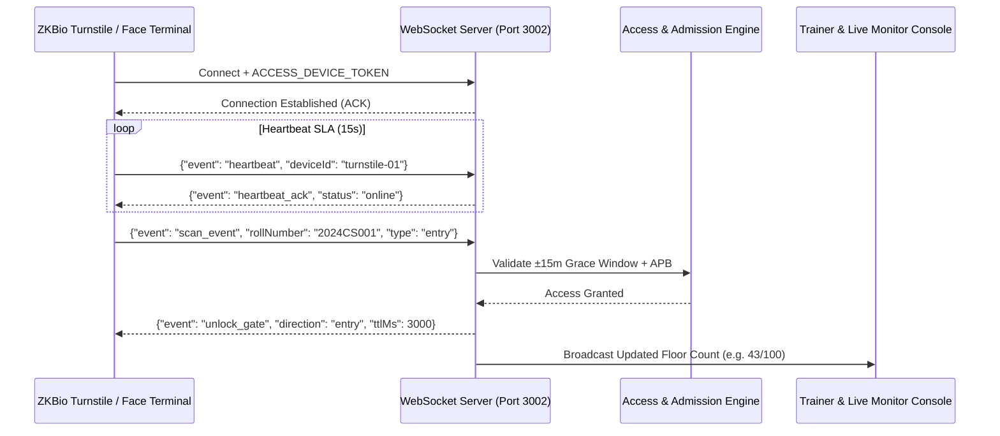

# College Gym Management System — Real-Time WebSocket & Hardware Protocol Reference

## 1. Overview & Architecture

The College Gym System operates dedicated WebSocket channels for sub-second bidirectional communication with hardware turnstiles, live floor monitoring consoles, and biometric facial vector edge synchronizers.

- **WebSocket Port:** `3002` (Configurable via `ACCESS_WS_PORT`)
- **Secure Endpoint (Production):** `wss://gym.lazplay.in/ws` (proxied via Nginx `Connection: Upgrade`)
- **Local Dev Endpoint:** `ws://localhost:3002`
- **Heartbeat Interval:** 15 seconds (Ping/Pong frame SLA)
- **Serialization:** RFC-8259 compliant JSON



---

## 2. Authentication & Handshake Protocol

Hardware terminals and administrative supervision dashboards authenticate during connection upgrade using either HTTP headers or initial connection payload.

### Method A: Connection Upgrade Headers
```http
GET /ws/hardware HTTP/1.1
Host: gym.lazplay.in
Upgrade: websocket
Connection: Upgrade
Sec-WebSocket-Key: dGhlIHNhbXBsZSBub25jZQ==
Sec-WebSocket-Version: 13
X-Device-Token: zkbio_turnstile_hw_token_rec_2026
X-Device-ID: turnstile-entry-01
```

### Method B: In-Band Handshake Message
If connecting from constrained embedded hardware, terminals must send an authentication frame within **3000ms** of TCP socket establishment:
```json
{
  "type": "AUTH_HANDSHAKE",
  "payload": {
    "deviceToken": "zkbio_turnstile_hw_token_rec_2026",
    "deviceId": "turnstile-entry-01",
    "deviceType": "zkbio_cv_speedface",
    "firmwareVersion": "v4.2.1-rec"
  }
}
```

---

## 3. Real-Time WebSocket Channels

### 3.1 Channel: Live Floor Occupancy (`/ws/occupancy`)
Subscribed by Reception Screens, Trainer Desks, and Student Mobile PWAs.

#### Event: `FLOOR_OCCUPANCY_UPDATE`
Broadcast whenever an individual enters, exits, or is manually checked out.
```json
{
  "event": "FLOOR_OCCUPANCY_UPDATE",
  "timestamp": "2026-08-19T10:45:00.000Z",
  "data": {
    "currentOccupancy": 42,
    "maxCapacity": 100,
    "occupancyPercentage": 42.0,
    "isNearingCapacity": false,
    "breakdown": {
      "hostellers": 26,
      "dayScholars": 12,
      "staff": 3,
      "authorizedVIPs": 1
    },
    "currentSlot": {
      "slotId": "slot-uuid-1234",
      "timeWindow": "10:00 - 11:00",
      "totalBooked": 55
    }
  }
}
```

---

### 3.2 Channel: Turnstile Hardware Telemetry & Control (`/ws/turnstile`)
Bidirectional stream between ZKBio access controllers and the Admission Engine.

#### Message From Device: `SCAN_EVENT`
Triggered when an optical facial scanner or RFID badge reads a student credential.
```json
{
  "event": "SCAN_EVENT",
  "messageId": "msg-872394",
  "deviceId": "turnstile-entry-01",
  "eventType": "entry",
  "identifierType": "roll_number",
  "identifierValue": "2024CS001",
  "verificationMode": "face",
  "confidenceScore": 0.982,
  "timestamp": "2026-08-19T10:45:02.120Z"
}
```

#### Message From Server: `ADMISSION_DECISION`
Emitted by server within **< 300ms** to actuate physical solenoid locks.
```json
{
  "event": "ADMISSION_DECISION",
  "replyToMessageId": "msg-872394",
  "deviceId": "turnstile-entry-01",
  "accessGranted": true,
  "action": "UNLOCK_SOLENOID",
  "direction": "entry",
  "pulseDurationMs": 3000,
  "screenMessage": "Welcome Karthik Raja (CSE)",
  "audioTone": "success_beep"
}
```

#### Denial Decision Example (Anti-Pass-Back / Out of Window)
```json
{
  "event": "ADMISSION_DECISION",
  "replyToMessageId": "msg-872394",
  "deviceId": "turnstile-entry-01",
  "accessGranted": false,
  "action": "LOCK_GATE",
  "screenMessage": "ACCESS DENIED: Outside ±15m Slot Window",
  "audioTone": "error_buzz"
}
```

---

### 3.3 Channel: Biometric Face Vector Synchronization (`/ws/biometrics`)
Manages asynchronous edge distribution of 512-dimensional facial recognition vectors from MinIO/Postgres down to physical ZKBio terminals.

#### Event: `SYNC_TASK_DISPATCH`
```json
{
  "event": "SYNC_TASK_DISPATCH",
  "batchId": "batch-sync-8841",
  "targetDeviceId": "turnstile-entry-01",
  "command": "UPSERT_FACE_TEMPLATE",
  "data": {
    "personId": "per-101",
    "rollNumber": "2024CS001",
    "name": "Karthik Raja",
    "templateVersion": "v5.8",
    "faceVectorBase64": "UklGRiQAAABXRUJQVlA4IBgAAAAwAQCdASoBAAEAD8D+JaQAA3AA/uaIAAA="
  }
}
```

#### Event: `SYNC_TASK_ACK`
Sent by terminal upon saving vector to local embedded flash storage.
```json
{
  "event": "SYNC_TASK_ACK",
  "batchId": "batch-sync-8841",
  "deviceId": "turnstile-entry-01",
  "personId": "per-101",
  "status": "SUCCESS",
  "localTemplateId": "ZK_00492"
}
```

---

### 3.4 Channel: Gym Floor Supervision & Overstayer Alerts (`/ws/floor-alerts`)
Pushed to Trainer Floor Manager tablet interfaces.

#### Event: `OVERSTAY_ALERT`
Fires automatically when an occupant remains inside > 75 minutes.
```json
{
  "event": "OVERSTAY_ALERT",
  "severity": "WARNING",
  "personId": "per-102",
  "name": "Priya Sharma",
  "rollNumber": "2024CS002",
  "entryTime": "2026-08-19T06:02:00.000Z",
  "elapsedMinutes": 83,
  "slotTime": "06:00 - 07:00",
  "suggestedAction": "Request immediate checkout or apply manual floor checkout"
}
```

---

## 4. Hardware Heartbeat & Liveness SLA

Every hardware terminal must emit a heartbeat frame every **15 seconds**.

```json
{
  "event": "HEARTBEAT",
  "deviceId": "turnstile-entry-01",
  "uptimeSeconds": 86400,
  "relayStatus": "nominal",
  "opticalSensors": "clear",
  "ambientTempC": 28.4
}
```

### Health State Machine:
- **`online`**: Received heartbeat within last 30 seconds.
- **`degraded`**: Missed 2 heartbeats (30–60s). Warning flag raised in Admin Console.
- **`offline`**: No heartbeat for > 60 seconds. Fallback to offline RFID verification cache.

---

## 5. Reconnection & Backoff Strategy

Clients and embedded terminals should implement exponential backoff with jitter upon disconnect:

$$\text{Delay} = \min(\text{base} \times 2^{\text{attempt}} + \text{jitter}, \text{max\_backoff})$$

- **Base Delay:** 1000ms
- **Max Delay:** 30,000ms
- **Jitter:** $\pm 500\text{ms}$ random variance to prevent thundering herds on network recovery.
